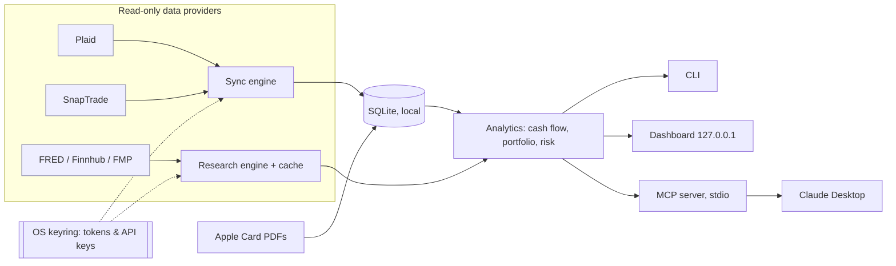

# finintel

**A private, security-first personal finance & investment intelligence system — with a Claude (MCP) connector.**

finintel pulls your bank, credit-card and brokerage data into a local database on your own computer,
analyzes cash flow, portfolio allocation and risk, writes data-driven 12-point stock memos, and lets
Claude answer questions about *your real numbers* through a Model Context Protocol server.

> **Read-only by design.** finintel never moves money, pays bills or places trades — there is no code
> path that can. It analyzes; you decide and act yourself.

---

## Features

| Area | What it does |
|---|---|
| **Accounts** | Banks & cards via **Plaid** (transactions + liabilities, read-only); brokerage via **SnapTrade** (read-only); Apple Card via statement-PDF import |
| **Cash flow** | Monthly income vs spending, internal-transfer matching, recurring-charge detection, user rules (e.g. "Zelle to X = rent"), planned expenses (tuition installments, repairs), month-by-month outlook, "how much can I invest?" plan |
| **Owed to me** | Track money others owe you for charges on your cards, excluded from your debt |
| **Portfolio** | Allocation vs targets (cash shown separately), concentration warnings (single stock > 10%), unrealized gains, value history, buy-only plan for new money |
| **Research** | 12-point memo per ticker from **FRED** (macro), **Finnhub** (price, metrics, analysts, news) and **FMP** (statements): growth, margins, balance sheet, free cash flow, valuation vs Treasury yield, price action/beta, risks, and fit with your plan. Facts and opinions are labeled separately |
| **Risk** | Cash runway (also "if outside support paused"), bills vs cash, stress tests (correction, 2022 bear, 2008 crash, 2000 tech bust) with historical recovery times, estimated volatility, 1-in-20 bad year |
| **Automation** | Daily scheduled sync + encrypted backup (Windows Task Scheduler, catches up after sleep) |
| **Interfaces** | CLI (`fin ...`), local web dashboard (FastAPI + Chart.js, installable PWA), and a **Claude MCP server** |

## Architecture



```
fin/            core: config, secrets (keyring), field encryption, redacting logs, SQLite models
fin/providers/  Plaid & SnapTrade adapters + mapping
fin/analytics/  cash flow, rules, forecast, receivables, portfolio, risk
fin/research/   FRED / Finnhub / FMP clients, file cache, 12-point memo
fin/web/        FastAPI dashboard (token + host/origin checks)
fin_mcp/        MCP server + tool implementations for Claude
tests/          100+ tests (fakes for every external service)
```

## Security design

- **No bank or brokerage passwords** ever touch finintel — you sign in on Plaid's / SnapTrade's own pages.
- **Secrets live in the OS keyring** (Windows Credential Manager): API keys, bank access tokens, the
  field-encryption key, the backup passphrase. Never in code, `.env`, logs, cache or git.
- **Field encryption** (Fernet) for sensitive database columns.
- **Redacting logger**: tokens, keys, emails and long account numbers are masked; nothing secret is logged.
- **Least privilege**: Plaid `transactions` + `liabilities` only (no `auth`, no `transfer`); SnapTrade
  connections should be created read-only.
- **Local-only dashboard**: binds to `127.0.0.1`, per-launch token, Host/Origin checks (blocks DNS
  rebinding). Optional private remote access through Tailscale only.
- **Encrypted backups** (scrypt + Fernet) that contain data but *no* tokens or keys — a stolen backup
  can't reach any account.
- Research API keys are stripped from URLs in errors and never written to the cache.

See [SECURITY.md](SECURITY.md).

## Quick start (sandbox — fake bank data)

Requirements: Python 3.12, [uv](https://docs.astral.sh/uv/), Windows (macOS/Linux work for everything
except Task Scheduler). Get free Plaid **Sandbox** keys at dashboard.plaid.com.

```bash
git clone https://github.com/Druizlince/finintel && cd finintel
uv sync
uv run python -m fin init
uv run python -m fin secret set plaid_client_id
uv run python -m fin secret set plaid_secret          # sandbox secret
uv run python -m fin plaid sandbox-link               # links Plaid's fake test bank
uv run python -m fin cashflow
uv run python -m fin app                              # opens the dashboard
uv run pytest -q
```

Optional research keys (free tiers): `fred_api_key`, `finnhub_api_key`, `fmp_api_key`
(`uv run python -m fin secret set <name>`), then:

```bash
uv run python -m fin macro
uv run python -m fin research NVDA --planned 20000
uv run python -m fin portfolio --new-money 10000
uv run python -m fin risk --new-money 10000 --keep-cash 3000 --pick NVDA
```

Encrypted backups and the daily job:

```bash
uv run python -m fin backup setup        # choose a passphrase (keep it in a password manager)
uv run python -m fin backup && uv run python -m fin backup verify
uv run python -m fin schedule install --time 07:30
```

## Claude Desktop (MCP)

Add to `claude_desktop_config.json` (Windows: `%APPDATA%\Claude\`):

```json
{ "mcpServers": { "finintel": {
    "command": "C:\\path\\to\\finintel\\.venv\\Scripts\\python.exe",
    "args": ["-m", "fin_mcp"] } } }
```

Then ask Claude things like *"What's my cash runway?"*, *"Memo on GOOGL"*, *"How should I split $5,000
toward my targets?"*. Tools: `get_overview`, `get_cashflow`, `get_investing_plan`, `get_upcoming`,
`search_transactions`, `get_holdings`, `get_portfolio`, `research_stock`, `get_macro`, `get_risk`,
`owed_to_me`, `sync_now`.

## Tech stack

Python 3.12 · SQLAlchemy 2 · SQLite (WAL) · FastAPI · Uvicorn · Pydantic · keyring · cryptography ·
plaid-python · SnapTrade SDK · pypdf · MCP SDK · pytest · uv

## Disclaimer

Personal project, for education. **Not financial, tax or legal advice.** Scores and scenarios are
rules of thumb and historical estimates, not predictions. Not affiliated with Plaid, SnapTrade,
Anthropic, Fidelity, FRED, Finnhub or Financial Modeling Prep. Respect each provider's terms — the free
tiers used here are for personal use.

## License

[MIT](LICENSE)
